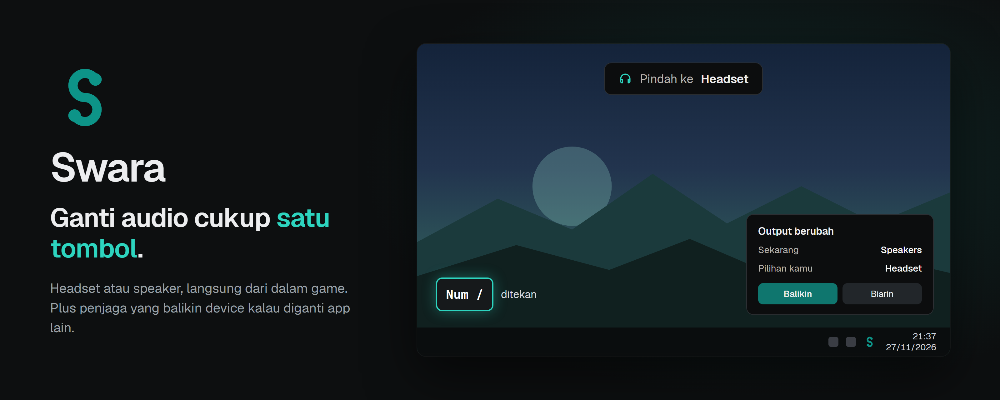

<p align="center"></p>

<h1 align="center">Swara</h1>

<p align="center">
  <a href="https://kurohiko.id">kurohiko.id</a> ·
  <a href="https://ko-fi.com/kurohikoid">Traktir kopi di Ko-fi</a> ·
  <a href="https://saweria.co/Kurohiko">Dukung lewat Saweria</a> ·
  <a href="https://kurohikotopup.com">Top up game di KurohikoTopUp</a>
</p>

<p align="center"><a href="README.md">English</a> · <b>Bahasa Indonesia</b></p>

---

**Ganti output audio pakai hotkey atau shortcut keyboard.**

Gue Kurohiko. Sehari-hari gue sering banget bolak-balik headset sama speaker. Masalahnya, buka panel Sound Windows pas lagi di tengah game itu ribet banget.

Belum lagi ada aplikasi yang diem-diem ganti default device pas baru dibuka atau pas dicolok ulang. Ujung-ujungnya baru ngeh pas suaranya malah keluar dari tempat yang salah.

Swara beresin dua hal itu: satu tombol buat tiap device, plus penjaga yang ngunci pilihan lu biar nggak keganti sendiri.

*Swara* artinya suara.

## Fitur

- **Hotkey per device**: satu baris berisi tombol dan device. Bisa tombol polos (misalnya Numpad) atau kombinasi Ctrl, Alt, Shift, dan Win, dari app atau game apa pun.
- **Putar bergantian**: pakai hotkey yang sama di beberapa baris, maka tombol itu memutar device-device tersebut sesuai urutan baris. Geser baris untuk mengubah urutan.
- **Penjaga**: output dan input masing-masing punya mode: Mati, Notif, atau Auto. Notif memunculkan popup dengan pilihan **Balikin**, **Biarin**, atau **Ingetin beberapa menit lagi**. Auto langsung membalikkan sendiri. Penjaga berhenti sendiri kalau ada app yang terus-terusan rebutan device.
- **Device komunikasi ikut pindah**: saat ganti, device komunikasi Windows ikut pindah, jadi Discord ikut. Matikan kalau Discord sengaja tetap di headset.
- **Nama tampilan** per device, dan nama device muncul sebentar di layar setelah ganti tanpa mengambil fokus dari game (bisa dimatikan).
- **Menu tray**: pilih device langsung dari ikon tray.
- **Jalankan sebagai admin** supaya hotkey tetap jalan saat game yang berjalan sebagai administrator sedang fokus.
- Jalan saat Windows nyala, cek update dari halaman rilis repo ini, Bahasa Indonesia dan English.
- **Ringan**: satu exe, sekitar 4 MB RAM saat diam, dan tidak ada yang berjalan di belakang sampai kamu menekan tombol atau device berubah.

## Instalasi

Unduh **Swara-Setup-&lt;versi&gt;.exe** atau versi portable (zip) dari [Releases](../../releases/latest). Installer menanyakan "Pasang untuk semua pengguna" (perlu untuk **Jalankan sebagai admin**) atau "Pasang hanya untuk saya" (tanpa hak admin). Versi zip tanpa installer dan tanpa mode admin.

> **Windows SmartScreen:** rilis belum ditandatangani (code-signed), jadi Windows mungkin bilang "Windows protected your PC". Klik **More info → Run anyway**.

Swara jalan di tray. Klik ikonnya untuk membuka Pengaturan:

1. **Tombol**: tambah baris, tekan tombol yang kamu mau, lalu pilih device.
2. **Penjaga**: pilih device utama dan device komunikasi untuk output dan input, lalu pilih mode.
3. Tutup jendelanya. Swara tetap jalan di tray.

### Hotkey tidak jalan di League of Legends atau game lain?

Hotkey sudah jalan di kebanyakan game, termasuk League of Legends. Kalau game kamu jalan sebagai administrator, Windows menyembunyikan tombol dari app biasa selama game itu fokus. Nyalakan **Pengaturan → Umum → Jalankan sebagai admin**. Izinnya diminta sekali, tanpa prompt saat login. Butuh akun administrator Windows dan pilihan **Pasang untuk semua pengguna**.

## Privasi

Halo, aku Kurohiko, developer Swara. Aku sangat menghargai privasi kalian.

Supaya Swara bisa terus berkembang ke arah yang tepat, aku butuh beberapa data dasar: berapa orang yang menginstal, fitur apa saja yang dipakai, dan versi Windows yang kalian gunakan. Dari situ aku bisa melihat fitur mana yang layak ditingkatkan, dan mana yang jarang dipakai.

Semua data ini **sepenuhnya anonim**. Aku tidak tahu siapa yang menginstal Swara, dan tidak tahu siapa yang memakai fitur apa.

**Yang dikirim:**

- ID acak yang dibuat saat Swara pertama kali dibuka. ID ini tidak terhubung ke akun, nama, atau perangkat kalian.
- Versi Swara, versi Windows, arsitektur CPU (x64/arm64), dan bahasa sistem.
- Negara, diperkirakan dari koneksi. Alamat IP tidak disimpan.
- Catatan saat Swara diinstal, diupdate, dan dibuka (paling banyak sekali sehari).
- Nama fitur yang aktif: penjaga output dan input, jalan saat Windows nyala, jalankan sebagai admin, nama di layar, ikut mengganti device komunikasi, apakah kalian memakai nama tampilan, dan bahasa aplikasi. Tiap fitur dihitung paling banyak sekali sehari, jadi tidak ada catatan per tombol.
- Pesan error kalau ada masalah, dengan semua path folder dibuang dan nama user disamarkan.

**Yang tidak pernah dikirim:** nama atau ID device, nama tampilan kalian, hotkey kalian, isi pengaturan, dan audio apa pun.

Data dikirim ke server milikku sendiri (`dash.kurohiko.id`), tidak dijual, dan tidak dibagikan ke pihak lain. Kode pengirimnya terbuka di [`src/stats.rs`](src/stats.rs). Kalau tetap tidak ingin mengirim apa pun, blokir `dash.kurohiko.id` di firewall atau file hosts. Swara tetap berjalan normal.

## Build dari source

Butuh Rust (stable, toolchain MSVC) di Windows 10/11.

```
cargo build --release
```

Exe-nya ada di `target/release/swara.exe`. Jalankan, lalu Swara tinggal di tray; klik ikon tray untuk pengaturan. Installer dibuat dengan Inno Setup: `powershell -File installer/build.ps1`.

## Dukungan

Bug dan ide: [buka issue](../../issues), atau pakai **Pengaturan → Umum → Lapor bug**.

Kalau Swara menghemat perjalananmu ke panel Sound, kamu bisa [traktir kopi di Ko-fi](https://ko-fi.com/kurohikoid), [dukung lewat Saweria](https://saweria.co/Kurohiko), atau top up game di [KurohikoTopUp](https://kurohikotopup.com).

Hak cipta dilindungi, lihat [LICENSE](LICENSE). Jendela pengaturan dibuat pakai [Slint](https://slint.dev) dengan Slint Royalty-free License.
