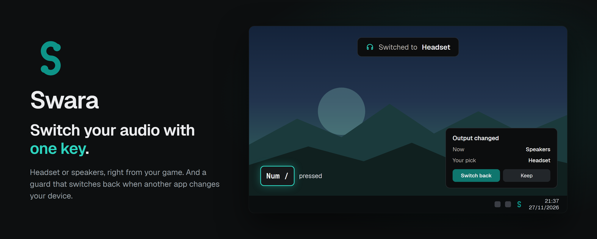

<p align="center"></p>

<h1 align="center">Swara</h1>

<p align="center">
  <a href="https://kurohiko.id">kurohiko.id</a> ·
  <a href="https://ko-fi.com/kurohikoid">Buy me a coffee on Ko-fi</a> ·
  <a href="https://saweria.co/Kurohiko">Donate via Saweria</a> ·
  <a href="https://kurohikotopup.com">Game top-ups at KurohikoTopUp</a>
</p>

<p align="center"><b>English</b> · <a href="README.id.md">Bahasa Indonesia</a></p>

---

**Switch your audio with a single key.**

I'm Kurohiko. I switch between my headset and speakers countless times a day, and alt-tabbing to dig through the Windows sound panel mid-game gets annoying fast.

To make things worse, some apps quietly hijack your default audio device on startup or reconnect, and you only realize it once the sound blasts from the wrong place.

Swara fixes both: dedicated hotkeys per device, plus a built-in Guard that keeps your audio exactly where you want it.

*Swara* means voice or sound in Indonesian.

## Features

- **A hotkey per device**: each row pairs a key with a device. Plain keys (like the numpad) or combos with Ctrl, Alt, Shift and Win, from any app or game.
- **Cycle**: put the same hotkey on several rows and it steps through those devices in row order. Drag rows to reorder them.
- **Guard**: output and input each get a mode: Off, Notify or Auto. Notify shows a popup with **Switch back**, **Keep** or **Remind in a few minutes**. Auto switches back by itself. The guard pauses on its own when an app keeps fighting over a device.
- **Communications device too**: switching also moves the Windows communications device, so Discord follows. Turn it off if Discord should stay on your headset.
- **Device nicknames**, and a short on-screen name after each switch that never steals focus from your game (can be turned off).
- **Tray menu**: pick a device straight from the tray icon.
- **Run as admin** so hotkeys keep working while a game running as administrator is focused.
- Start with Windows, update check from this repository's releases, English and Bahasa Indonesia.
- **Small**: one exe, about 4 MB of RAM while idle, and nothing running in the background until you press a key or a device changes.

## Install

Download **Swara-Setup-&lt;version&gt;.exe** or the portable zip from [Releases](../../releases/latest). The installer asks "Install for all users" (needed for **Run as admin**) or "Install for me only" (no admin rights needed). The portable zip has no installer and no admin mode.

> **Windows SmartScreen:** releases aren't code-signed yet, so Windows may say "Windows protected your PC". Click **More info → Run anyway**.

Swara starts in the tray. Click its icon to open Settings:

1. **Keys**: add a row, press the key you want, and pick the device.
2. **Guard**: pick your main and communications device for output and input, then a mode.
3. Close the window. Swara keeps running in the tray.

### Hotkey not working in League of Legends or other games?

Hotkeys already work in most games, League of Legends included. If you run a game as administrator, Windows hides your keys from normal apps while it is focused. Turn on **Settings → General → Run as admin**. It asks for permission once, with no prompt at sign-in. It needs a Windows administrator account and the **Install for all users** option.

## Privacy

Hi, I'm Kurohiko, the developer of Swara. I care a lot about your privacy.

To keep Swara moving in the right direction, I need a few basic numbers: how many people install it, which features get used, and which Windows version you're on. That tells me what is worth improving, and what hardly anyone uses.

All of this is **fully anonymous**. I don't know who installed Swara, and I don't know who uses which feature.

**What is sent:**

- A random ID created the first time Swara opens. It isn't linked to your accounts, your name, or your device.
- Swara version, Windows version, CPU architecture (x64/arm64), and system language.
- Country, estimated from the connection. IP addresses are not stored.
- A note when Swara is installed, updated, and opened (at most once a day).
- Names of the features that are switched on: the output and input guard, start with Windows, run as admin, the on-screen name, switching the communications device too, whether you use nicknames, and the app language. Each one is counted at most once a day, so there is no per-press record.
- Error messages when something goes wrong, with every folder path removed and your user name masked.

**Never sent:** device names or IDs, your nicknames, your hotkeys, the contents of your settings, or any audio.

The data goes to my own server (`dash.kurohiko.id`). It is not sold or shared with anyone. The code that sends it is open in [`src/stats.rs`](src/stats.rs). If you'd rather send nothing, block `dash.kurohiko.id` in your firewall or hosts file. Swara keeps working normally.

## Build from source

Needs Rust (stable, MSVC toolchain) on Windows 10/11.

```
cargo build --release
```

The exe lands in `target/release/swara.exe`. Run it and it lives in the tray; click the tray icon for settings. The installer is built with Inno Setup: `powershell -File installer/build.ps1`.

## Support

Bugs and ideas: [open an issue](../../issues), or use **Settings → General → Report a bug**.

If Swara saved you a trip to the sound panel, you can [buy me a coffee on Ko-fi](https://ko-fi.com/kurohikoid), [donate on Saweria](https://saweria.co/Kurohiko), or top up your games at [KurohikoTopUp](https://kurohikotopup.com).

All rights reserved, see [LICENSE](LICENSE). The settings window is built with [Slint](https://slint.dev) under the Slint Royalty-free License.
